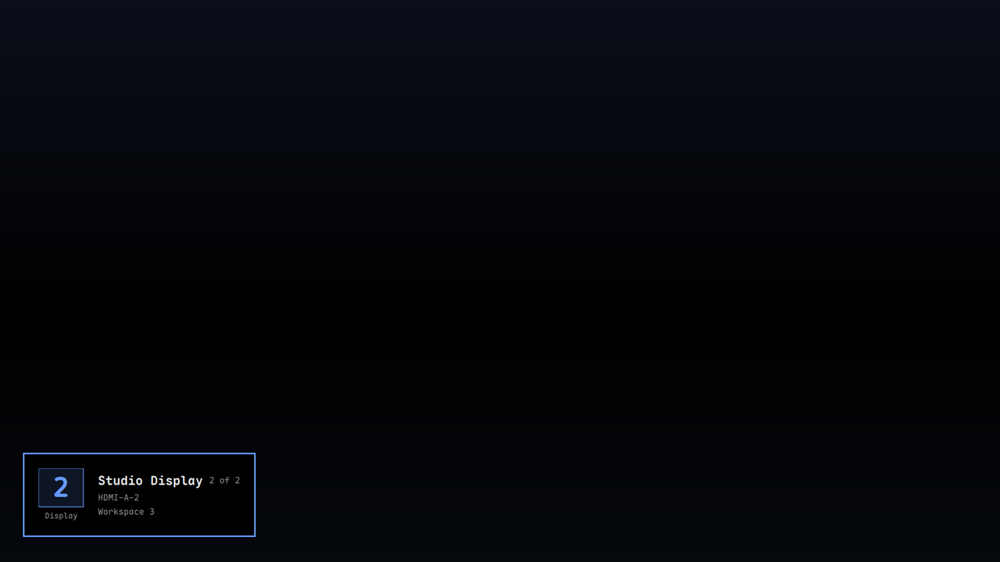

# Monitor Flash



An Omarchy shell plugin that shows which display just became active when
keyboard focus moves to another monitor. With two or more displays, the moving
pointer is easy to miss; this card puts the display number, connector, panel
model, and current workspace in the middle of the display that received focus.

It follows Omarchy's default monitor bindings and needs no configuration:

- `Ctrl + Alt + Tab` — focus next monitor
- `Ctrl + Alt + Shift + Tab` — focus previous monitor

Clicking another display or moving focus any other way triggers the same card.
The plugin adds no keybinding, changes no Hyprland setting, and takes neither
clicks nor keyboard focus.

## Requirements

- Omarchy 4 (Quattro) with the Omarchy shell
- Hyprland
- Two or more outputs for the card to have a reason to appear

There are no external dependencies and no background commands.

## Install

```bash
omarchy plugin add https://github.com/DimDoremy/omarchy-monitor-flash --enable
```

Enable or disable it later:

```bash
omarchy plugin enable dimdoremy.monitor-flash
omarchy plugin disable dimdoremy.monitor-flash
```

Saved changes to the plugin reload automatically; a shell restart is not
needed.

## Use

Switch monitors. The card appears in the bottom-left corner of the newly
focused display for about a second, then fades out. If the pointer is resting
in that corner while the card is still visible, the card slides to the
bottom-right so it never sits under the cursor.

Show it on demand:

```bash
omarchy-shell dimdoremy.monitor-flash flash
```

Read the plugin's current state:

```bash
omarchy-shell dimdoremy.monitor-flash state
```

The first focus value after login is treated as a baseline, so nothing flashes
when the shell starts.

## How it works

The plugin is a keep-loaded `overlay` that watches Hyprland's
`focusedMonitor`. On a real change it maps a transparent, input-transparent
layer surface on the new output, draws one card in the bottom-left corner, and
hides again. While the card is up, a 100 ms `hyprctl cursorpos` check moves it
to the bottom-right if the pointer is over it, then stops. Nothing is written
to disk and the compositor configuration is never modified.

The card uses the shell's theme tokens (surface color, border, corner radius,
fonts, accent) and Omarchy's language setting. English, Simplified Chinese, and
Traditional Chinese strings ship in `i18n/`; any other language falls back to
English.

## Remove

```bash
omarchy plugin remove dimdoremy.monitor-flash
```

If you added the plugin to `~/.config/omarchy/shell.json` by hand, also remove
its `id` from the `plugins` array.

## Development

Run the repository checks from the project root:

```bash
tests/run.sh
```

The script validates the manifest with `omarchy plugin validate`, lints the QML
against the installed shell, and runs the monitor-numbering tests with Node.
`preview.png` is rendered from `MonitorCard.qml` with the real theme tokens.

## License

MIT. See [LICENSE](LICENSE).
